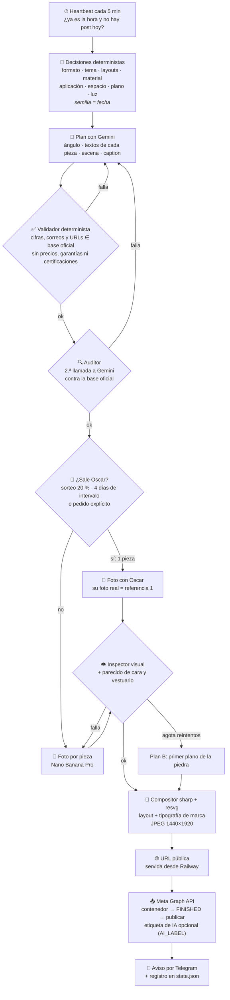
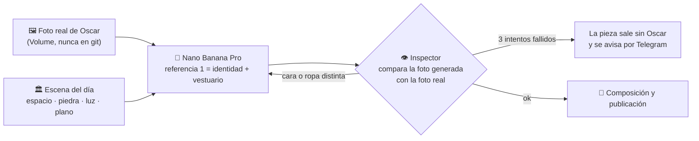

<div align="center">

# Millimeter · SM Automation

**Un agente autónomo que planifica, diseña, valida y publica contenido en Instagram cada día, sin intervención humana y sin inventar un solo dato.**


[](https://github.com/Kin9Zeus/Millimeter-SM-Automation/actions/workflows/ci.yml)

[El problema](#-el-problema) · [Cómo funciona](#-cómo-funciona) · [Decisiones de ingeniería](#-decisiones-de-ingeniería) · [Avatar de marca](#-avatar-de-marca-oscar-en-escena) · [Control por Telegram](#-control-por-telegram) · [Operación y métricas](#-operación-y-métricas) · [Despliegue](#-despliegue-en-railway) · [Límites](#-límites-conocidos)

</div>

---

## 🎯 El problema

[MILLIMETER by Casanova](https://www.millimetersouthamerica.com/) vende piedra natural en láminas ultrafinas (1–5 mm) para arquitectos y diseñadores en Colombia, Argentina, Perú y Brasil. Su cuenta de Instagram, [`@casanova_southamerica`](https://www.instagram.com/casanova_southamerica/), necesita **publicar a diario con calidad editorial**, y el reto es doble:

1. **Constancia sin un equipo de contenido.** Diseñar, redactar y publicar cada día es caro y fácil de abandonar.
2. **Cero margen de error en los datos.** En un producto técnico, una cifra inventada (peso, espesor, certificación) es un riesgo comercial. Los modelos generativos alucinan por naturaleza.

Este proyecto resuelve ambos: **un bot que trabaja solo, pero que está diseñado en torno a la desconfianza hacia su propio modelo de IA**. Cada texto, cada cifra y cada imagen pasa por barreras deterministas antes de llegar a Instagram.

## ✨ Qué hace

| | |
|---|---|
| 🗓️ **Publica solo, cada día** | Elige formato (post de 1 imagen o carrusel de 3 a 6), tema, layouts y material, y publica a la hora configurada. |
| 🧠 **Solo dice lo que sabe** | Gemini redacta usando exclusivamente una base de conocimiento oficial. Todo número, correo y URL del texto se comprueba contra ella. |
| 🖼️ **Fotos sin texto, tipografía exacta** | Nano Banana Pro genera la fotografía; un compositor propio superpone la tipografía de marca. El nombre, las tildes y las cifras nunca salen deformados. |
| 👁️ **Control de calidad visual** | Un inspector (visión por IA) rechaza juntas visibles, piedra doblada, texto fantasma o personas no pedidas, y regenera con correcciones. |
| 👤 **Avatar de marca** | De vez en cuando, una pieza incluye a Oscar, del equipo MILLIMETER, con **su cara y su vestuario exactos** tomados de una foto real. Un inspector compara cada imagen con esa foto y descarta las que no se parecen. [Ver cómo funciona ↓](#-avatar-de-marca-oscar-en-escena) |
| 🛡️ **Idempotente y con tope de gasto** | Un reinicio retoma donde quedó, nunca publica dos veces y nunca supera el presupuesto diario de imágenes. |
| 📱 **Se controla desde el móvil** | Comandos de Telegram para forzar un post, encolar o fijar ideas por día, pausar o cambiar la hora. |
| 📈 **Mide lo que publica** | `/metricas` trae alcance, guardados, compartidos y el mejor y peor post, y compara formatos y temas. |
| 🗓️ **Agenda visible** | `/semana` muestra, sin gastar nada, el formato y el tema exactos de los próximos 7 días. |
| 🩺 **Se autodiagnostica** | `/salud` revisa Instagram, Gemini, token, dominio, disco y errores; `/gasto` estima el gasto y avisa al acercarse al presupuesto. |

## 🏗️ Cómo funciona



### Las tres barreras contra la alucinación

La IA propone; el código decide. La política de la marca es que **la IA nunca inventa datos técnicos**, así que se aplica en capas independientes:

1. **Base de conocimiento cerrada** ([`knowledge/facts.json`](knowledge/facts.json)). Cada afirmación del plan debe citar un `fact_id` existente. Lo que no está ahí, el bot no lo dice.
2. **Validador determinista** ([`src/validate.mjs`](src/validate.mjs)). Es código, no un modelo: rechaza cualquier número, correo o URL ausente de la base y un léxico prohibido (precios, descuentos, garantías, certificaciones, testimonios, «sin juntas» como promesa absoluta).
3. **Auditor + inspector visual.** Una segunda pasada de Gemini revisa el plan contra la base, y otra revisa cada imagen generada antes de aceptarla.

Si tras 4 rondas el plan no supera las barreras, **ese día no se publica**. Es preferible el silencio a un dato falso.

## 🧩 Decisiones de ingeniería

| Decisión | Por qué |
|---|---|
| **Texto compuesto por código, no por el modelo de imagen** | Los generadores de imagen deforman tildes, logotipos y cifras. Generar la foto sin texto y componer con `sharp` + `resvg` + fuentes embebidas garantiza una tipografía exacta. |
| **Aleatoriedad con semilla = fecha** | Un reintento del mismo día conserva formato y layouts, pero el feed varía entre días. Es reproducible y testeable. |
| **Pipeline idempotente con checkpoints** | Cada etapa persiste en `state.json`. Un crash a mitad de ejecución no regenera (ni cobra) lo ya hecho. Tras un fallo ambiguo al publicar, el bot consulta Instagram antes de reintentar para no duplicar. |
| **Presupuesto como invariante** | Máx. 4 intentos/día, 3 intentos de foto por pieza y un tope duro de imágenes diarias (`MAX_IMAGES_PER_DAY`). Si se alcanza, el bot se detiene y avisa. |
| **Cascada de modelos** | Si el modelo de texto configurado no existe o falla, prueba una lista de candidatos y recuerda el que funciona. |
| **Renovación autónoma del token de Meta** | El token de larga duración (60 días) se renueva solo, se persiste en el volumen y avisa si no puede. |
| **Mínima superficie de dependencias** | Servidor HTTP con `node:http`, scheduler con `setInterval`, Telegram por *long polling*. Solo 3 dependencias de runtime: `@google/genai`, `sharp`, `@resvg/resvg-js`. |
| **Seguridad por diseño** | Autenticación admin con comparación en tiempo constante, sin URL ni token en logs o errores, rutas `/admin/*` que responden 404 si no hay token configurado y nombres de imagen no enumerables. |

## 👤 Avatar de marca: Oscar en escena

Una marca de lujo vende confianza, y la confianza tiene cara. Por eso, de vez en cuando, el bot pone a **Oscar** (del equipo MILLIMETER, con su autorización) dentro de las escenas: de pie junto a una chimenea de mármol, apoyado en un mueble de roble o sentado frente a un muro de travertino. Aparece con **su cara y su vestuario reales**, sin un modelo genérico ni ropa inventada.

### Cómo se consigue el parecido



| Capa | Qué hace |
|---|---|
| **Referencia siempre primera** | La foto de Oscar es siempre la **primera imagen** que recibe el modelo, y el prompt la nombra así. En un carrusel, la foto de continuidad de la escena va segunda y solo aporta material y estilo. |
| **Identidad exacta** | El prompt pide copiar la forma de la cara, los ojos, las cejas, la nariz, la sonrisa, el cabello, la barba, el tono de piel y la edad. También prohíbe embellecer, rejuvenecer o sustituirlo por un rostro genérico. |
| **Vestuario exacto** | Oscar viste **siempre** la ropa de la foto de referencia: mismas prendas, colores, textura, corbata, pañuelo y accesorios. Si se cambia la foto, cambia su vestuario. |
| **La piedra sigue siendo protagonista** | Oscar ocupa entre el 30 y el 50 % del alto del encuadre, no tapa la superficie de piedra y no toca cantos. Solo aparece en los layouts donde una persona cabe sin estorbar (A, B, D, E, F, H, I y K); nunca en las texturas ni en los recortes de detalle. |
| **Inspector de parecido** | El inspector visual recibe **dos imágenes**: la generada y la real. Rechaza la generada si la cara o la ropa no coinciden, si hay más de una persona, si la cara sale tapada o borrosa, o si hay manos deformes. Ante la duda, rechaza: un rostro solo «parecido» no se acepta. |
| **Degradación segura** | Si ningún intento supera el control, la pieza se regenera **sin** Oscar y el aviso de Telegram lo explica. El post del día nunca se pierde por culpa del avatar. |

### Cuándo aparece

- **Esporádico por diseño:** 20 % de probabilidad por post y al menos 4 días entre apariciones automáticas, en una sola pieza del post. Se configura con `AVATAR_CHANCE` y `AVATAR_MIN_GAP_DAYS`, o desde Telegram.
- **Bajo pedido:** `/oscar proximo` lo incluye en la siguiente publicación, y cualquier idea que lo mencione (`/idea`, `/forzar`, `/cambiar`) también lo incluye.
- **Decisión persistente:** el sorteo se hace una sola vez por post y queda en `state.json`. Un reintento no vuelve a sortear ni cambia la pieza elegida.

### Dónde vive la foto (privacidad)

Este repositorio es público, así que **la foto de Oscar nunca entra en git**. Vive en el Volume de Railway:

| Archivo | Origen | Prioridad |
|---|---|---|
| `avatar/oscar.jpg` | Opcional: el cliente envía una foto por Telegram con el pie `/oscar` | 1.ª |
| `avatar/base.jpg` | Foto oficial, subida con `railway run npm run avatar:base -- <foto>` | 2.ª |

`/oscar base` borra la foto enviada por Telegram y vuelve a la oficial. Las dos se normalizan al guardarse: se convierten a JPEG, se corrige la orientación, el lado mayor queda en 1536 px como máximo y se eliminan los metadatos. La subida de la foto base usa `PUT /admin/avatar` con `ADMIN_TOKEN`, y el script lo lee de las variables de Railway sin imprimirlo.

## 🎨 Motor de diseño

Doce layouts de marca, elegidos de forma determinista para que el feed nunca se vea repetitivo: la portada no repite ninguno de los tres últimos y no se repite layout dentro de un mismo carrusel.

| Layout | Descripción | Tema y espejo |
|---|---|---|
| **A** | Franja oscura sobre foto a sangre | — |
| **B** | Arco en el fondo del tema | tema |
| **C** | Textura + dato grande | — |
| **D** | Dividido: foto y panel de texto | tema · espejo |
| **E** | Portada a sangre con zona clara para el texto | — |
| **F** | Marco tipo revista | tema |
| **G** | Tipográfica con muestra circular | tema |
| **H** | Tarjeta de texto sobre foto a sangre | tema · espejo |
| **I** | Foto ancha arriba y texto debajo | tema |
| **J** | Foto con círculo de acercamiento del mismo detalle | tema · espejo |
| **K** | Arco lateral con columna de texto | tema · espejo |
| **L** | Cifra grande + escena en franja (el dato sin una textura plana) | tema |

Cada layout con fondo propio admite seis **temas de color dentro de la paleta de marca** (crema, lino, arena, travertino, café y café profundo) y cuatro admiten **espejo**: los 12 layouts producen decenas de presentaciones distintas sin salirse de la identidad. Tema y espejo también los decide el código, evitando lo usado en las últimas piezas.

**Variedad visual decidida por código, no por el modelo.** Un feed generado por IA tiende a repetirse (mismo salón, mismo roble, mismo plano frontal). Por eso [`variety.mjs`](src/variety.mjs) fija, para cada pieza, la **aplicación** de la piedra (una de las 8 oficiales, en 52 variantes), el **espacio**, el **plano** (16), la **luz** (14) y el **material**, y para cada post el **ambiente** (16 estilos con su paleta), la **arquitectura** (15 lenguajes: mediterránea, colonial, brutalista suave, loft, hacienda…) y un **objeto de decorado** por pieza (16), penalizando lo usado en los últimos 10 posts. Aplicación, espacio, material, plano y luz los exige el validador; la arquitectura y el decorado se **añaden a la escena por código**, así que no dependen de que el modelo obedezca. Las texturas planas (layouts C y G) quedan como recurso ocasional.

**La idea también se presenta distinto.** Además del tema, cada post recibe una **estructura editorial** (pregunta y respuesta, un dato protagonista, antes y después, afirmación breve, invitación al profesional, la escena habla, creencia y realidad, detalle constructivo, cómo trabajamos, cifras frente a frente), elegida según el tipo de tema y sin repetir las últimas. Cambia el gancho, el orden y el enfoque del texto, nunca los hechos.

Tipografía: *Cormorant Garamond* y *Montserrat* (SIL OFL 1.1), embebidas para renderizar sin depender de las fuentes del sistema.

## 📚 Conocimiento (lo que el bot «sabe»)

| Archivo | Para qué |
|---|---|
| [`knowledge/facts.json`](knowledge/facts.json) | Única fuente de datos afirmables (brochure + web oficial). |
| [`knowledge/guia-editorial.md`](knowledge/guia-editorial.md) | Marca, sistema de diseño, estructura del caption, copy y tono. |
| [`knowledge/topics.json`](knowledge/topics.json) | Banco de 96 temas (cada aplicación, cada frente de huella, cada límite de la piedra tradicional, cada canal de contacto y cada material autorizado tienen los suyos); se elige el menos usado recientemente. Son ángulos distintos sobre los mismos hechos: ninguno añade datos. |
| [`knowledge/materiales.json`](knowledge/materiales.json) | Los 9 materiales del catálogo y su descripción visual genérica. |

El **caption** sigue un esqueleto fijo del cliente: titular · problema · solución · 4 viñetas · tagline · CTA + contacto · banderas de los países · máx. 5 hashtags.

## 📱 Control por Telegram

El cliente da órdenes al bot desde un chat privado. No hay aprobación por pieza: solo órdenes, y los mismos chats reciben el aviso de cada publicación.

| Comando | Qué hace |
|---|---|
| `/estado` | Qué se publicó hoy, qué viene, ideas en cola, gasto de imágenes y estado del token. |
| `/semana` | Los próximos 7 días: formato y tema (o idea) de cada publicación. Es exacto y no consume Gemini. |
| `/cambiar <n> <idea>` | Fija una idea para el día *n* de `/semana`. `/cambiar <n> auto` vuelve al tema automático. |
| `/metricas [días]` | Alcance, vistas, guardados, compartidos e interacciones de los últimos 1–30 días (7 por defecto); mejor y peor post; comparación por formato y por tema. |
| `/gasto` | Gasto estimado de Gemini hoy, en el mes, proyección a fin de mes y últimos 7 días. |
| `/salud` | Chequeo de Instagram, Gemini, vencimiento del token, cuota de publicación, dominio público, disco, programador y errores recientes. |
| `/forzar` · `/forzar <idea>` | Publica un post extra ahora (2–5 min); con idea, sobre ese tema. |
| `/idea <texto>` | Encola una idea para la siguiente publicación programada. |
| `/ideas` · `/borrar_idea <n>` | Ver / quitar ideas de la cola. |
| `/previa` | Genera un borrador **sin publicar** y lo envía al chat. |
| `/oscar` | Estado del [avatar de marca](#-avatar-de-marca-oscar-en-escena): qué foto se usa, la probabilidad y la última aparición. |
| `/oscar proximo` · `/oscar 20` · `/oscar on`/`off` | Oscar en el siguiente post · probabilidad por post (%) · activar o desactivar las apariciones automáticas. |
| foto con el pie `/oscar` · `/oscar base` | Cambia su foto de referencia (opcional; también cambia su vestuario) · vuelve a la foto oficial. |
| `/pausar` · `/reanudar` | Detiene / reactiva las publicaciones automáticas. |
| `/hora HH:MM` | Cambia la hora diaria. |
| `/usuarios` · `/quitar <n>` · `/desvincular` | Gestionar quién puede dar órdenes. |
| `/ayuda` | Lista de comandos. |

Las ideas pasan por **las mismas barreras** que un post automático. La idea manda sobre el post (titular, caption y escena). Si una idea no se puede convertir en un post válido, el bot avisa el motivo: una orden manual (`/forzar`) no publica nada, y una idea de la cola publica un tema automático para no perder el día. Un fallo de API o de red **no consume** la idea.

<details>
<summary><b>Vinculación y seguridad</b></summary>

- **Puesta en marcha:** crea el bot con [@BotFather](https://t.me/BotFather), guarda su token en `TELEGRAM_BOT_TOKEN`, define `TELEGRAM_LINK_CODE` y envía `/vincular <código>` desde el chat.
- **Traspaso al cliente:** el cliente se vincula con el mismo comando; después se quita el chat del desarrollador (`/quitar`) y se **rota `TELEGRAM_LINK_CODE`** para invalidar el código usado.
- **Seguridad:** solo chats privados que enviaron el código correcto (5 intentos fallidos por hora y chat); *long polling* sin webhook expuesto; el token nunca aparece en logs. Sin `TELEGRAM_BOT_TOKEN`, los comandos quedan desactivados.

</details>

## 📈 Operación y métricas

Tres comandos de solo lectura que dan visibilidad sin pasar por los logs del servidor.

| | Qué mide | De dónde sale | Detalle de diseño |
|---|---|---|---|
| **`/metricas`** | Seguidores, alcance, vistas, visitas al perfil, y por post: alcance, guardados, compartidos, interacciones. | Instagram API (`/insights`) | Un post con menos de 24 h no entra al ranking (sus cifras aún se completan). Si Meta rechaza una métrica se reintenta con el conjunto mínimo; si falta el permiso de *insights* se muestran likes y comentarios y se explica qué falta. Caché de 30 min para no gastar cuota. Con menos de 10 posts avisa de que es tendencia, no veredicto. |
| **`/gasto`** | Imágenes, llamadas de texto e inspecciones visuales → USD. | `state.json` (intentos de foto) y un libro diario de llamadas a Gemini | Es una **estimación** con precios configurables (`IMAGE_COST_USD`, `TEXT_CALL_USD`, `INSPECT_CALL_USD`). Con `MONTHLY_BUDGET_USD` el bot avisa solo al 80 % y al 100 % (una vez por umbral y mes). |
| **`/salud`** | Latido del programador, configuración, última publicación y errores, token y cuota de Instagram, clave y modelos de Gemini, dominio público, espacio del volumen, Telegram. | Comprobaciones gratuitas (no generan texto ni imágenes) | Cada comprobación es independiente: una que falla se reporta como ❌ y el resto sigue. |

**`/semana` es exacta sin llamar al modelo.** Formato, tema y layouts salen de funciones deterministas (semilla = fecha), así que la agenda se calcula simulando el avance día a día con la misma lógica que usará el pipeline. Lo único que se decide ese día es la redacción. Las ideas fijadas con `/cambiar` se guardan con su fecha y tienen prioridad sobre la cola.

## 🚀 Despliegue en Railway

1. Railway → **New Project → Deploy from GitHub repo** → este repositorio.
2. **Networking → Generate Domain** (Meta descarga las imágenes desde ahí; el bot usa `RAILWAY_PUBLIC_DOMAIN`).
3. **Volume** montado en `/data` y `DATA_DIR=/data`.
4. Carga las variables de entorno (ver abajo).
5. Ensayo sin publicar:
   ```bash
   curl -X POST -H "Authorization: Bearer $ADMIN_TOKEN" \
     "https://<dominio>/admin/run?dry=1&count=3"
   ```
   y revisa `GET /admin/status` y los logs.
6. Con el ensayo aprobado, el bot publica solo cada día a la hora configurada.

El servicio expone `/health` para el *healthcheck* y reinicia automáticamente ante fallos ([`railway.json`](railway.json)).

### Variables de entorno

> [!IMPORTANT]
> Las credenciales viven **solo** en el gestor de variables de la plataforma. Plantilla en [`.env.example`](.env.example); el `.env` real está en `.gitignore`.

| Variable | Obligatoria | Nota |
|---|---|---|
| `GEMINI_API_KEY` | ✅ | Con facturación activa (Nano Banana Pro es de pago). |
| `META_ACCESS_TOKEN` | ✅ | Token de larga duración de Instagram Login. |
| `DATA_DIR` | ✅ en Railway | `/data` (Volume). |
| `ADMIN_TOKEN` | recomendada | Habilita `/admin/*`; cadena larga y aleatoria. |
| `IMAGE_ASPECT`, `IMAGE_SIZE` | no | `3:4` y `2K`. |
| `MAX_IMAGES_PER_DAY` | no | Tope duro de imágenes generadas por día (18). |
| `MONTHLY_BUDGET_USD` | no | Presupuesto mensual estimado: avisa al 80 % y 100 % (0 = sin avisos). |
| `IMAGE_COST_USD`, `TEXT_CALL_USD`, `INSPECT_CALL_USD` | no | Precios de referencia para `/gasto` (0.134 / 0.035 / 0.005). |
| `TZ_NAME`, `POST_HOUR`, `POST_MINUTE` | no | Por defecto `America/Bogota`, 10:00. |
| `PAUSED`, `DRY_RUN` | no | Interruptor de emergencia / modo ensayo. |
| `TELEGRAM_BOT_TOKEN`, `TELEGRAM_LINK_CODE` | no | Control y avisos por Telegram. |
| `AI_LABEL` | no | `true` marca los posts con la etiqueta «Información de IA» de Instagram (`is_ai_generated`). Por defecto `false`. |
| `AVATAR_ENABLED`, `AVATAR_CHANCE`, `AVATAR_MIN_GAP_DAYS` | no | Avatar de marca (por defecto `true`, `0.2`, `4`). La foto no es una variable: vive en el Volume ([ver arriba](#dónde-vive-la-foto-privacidad)). |
| `TELEGRAM_MAX_CHATS`, `TELEGRAM_CHAT_ID` | no | Máx. de chats vinculados (4) · chat extra solo de avisos. |

## 💻 Uso local

```bash
npm install
cp .env.example .env              # completa las claves
npm run once -- --whoami          # verifica el token de Meta
npm run once -- --content         # solo plan y textos (centavos)
npm run once -- --dry --count 3   # plan + fotos + composición, sin publicar (~USD 0.4–1)
railway run npm run avatar:base -- ruta/foto.jpg   # sube la foto base de Oscar al Volume de producción
npm test                          # 71 tests: validación, diseño, variedad, ideas, avatar, Telegram, métricas, salud, gasto
```

## 🗂️ Estructura

```
├── src/
│   ├── server.mjs      # HTTP (health, media, admin) + scheduler + arranque/cierre limpio
│   ├── pipeline.mjs    # orquestación idempotente del día
│   ├── content.mjs     # plan y caption con Gemini + auditor
│   ├── validate.mjs    # barreras deterministas anti-alucinación
│   ├── design.mjs      # formato, tema y layouts con semilla = fecha
│   ├── photo.mjs       # foto + inspector visual (incluye parecido del avatar) + reintentos con tope
│   ├── avatar.mjs      # avatar de marca: foto base/Telegram, sorteo esporádico y ajustes
│   ├── compose.mjs     # 12 layouts de marca con temas de color y espejo (sharp + resvg)
│   ├── meta.mjs        # Instagram API: contenedores, carruseles, renovación de token
│   ├── variety.mjs     # aplicación, espacio, plano, luz, ambiente, arquitectura, decorado, estructura editorial y aspecto gráfico (anti-repetición)
│   ├── telegram.mjs    # long polling y vinculación
│   ├── commands.mjs    # comandos del cliente
│   ├── agenda.mjs      # /semana: simulación determinista de los próximos días
│   ├── metrics.mjs     # /metricas: ranking y comparaciones sobre los insights
│   ├── spend.mjs       # /gasto: libro de llamadas y estimación en USD
│   ├── health.mjs      # /salud: comprobaciones independientes
│   ├── format.mjs      # fechas y etiquetas compartidas
│   └── state.mjs       # estado persistente (checkpoints, ideas, caché de métricas)
├── scripts/
│   └── upload-avatar.mjs  # sube la foto base del avatar (PUT /admin/avatar)
├── knowledge/          # base de conocimiento y guía editorial
├── assets/fonts/       # tipografía de marca (OFL)
├── test/               # node --test
└── railway.json
```

## ⚠️ Límites conocidos

- Meta exige URL pública para las imágenes: se sirven desde el propio servicio (`/media/<archivo>.jpg`, nombres no enumerables, 30 días).
- La API no soporta stickers interactivos de stories; el bot publica posts de feed.
- Las descripciones visuales de cada material son genéricas: el bot no puede garantizar que una piedra se vea idéntica a la real. Las imágenes son conceptuales y nunca representan proyectos reales.
- Por defecto los posts se publican sin la etiqueta «Información de IA» de Instagram (se activa con `AI_LABEL=true`). El bot no borra las marcas de origen de las imágenes, así que Instagram puede añadir la etiqueta por su cuenta.
- El parecido del avatar depende del modelo de imagen. El inspector descarta los intentos fallidos, pero conviene revisar las piezas con Oscar en el feed. Una foto de referencia nítida, frontal y bien iluminada da los mejores resultados.
- El bot es autónomo por diseño: se recomienda revisar el feed periódicamente y usar `PAUSED=true` ante cualquier duda.

## 🧰 Stack

**Node.js 22** (ESM) · **Gemini API** (`@google/genai`; texto + `gemini-3-pro-image`) · **sharp** + **@resvg/resvg-js** (composición) · **Instagram API / Meta Graph** · **Telegram Bot API** · **Railway** (Railpack, Volume, healthchecks) · `node --test`

## Licencia

© 2026 Devleck (Aleck Martinez). **Todos los derechos reservados.** El código se publica como caso de estudio de portafolio: puedes leerlo y ejecutarlo en local para evaluarlo, pero no copiarlo, redistribuirlo ni usarlo en otro producto sin permiso escrito. Las marcas, logotipos, fotografías y textos pertenecen a sus respectivos dueños. Ver [LICENSE](LICENSE) · Permisos: contact@devleck.com

---

<div align="center">

Hecho por [**Kin9Zeus**](https://github.com/Kin9Zeus) · Proyecto real en producción para MILLIMETER by Casanova

</div>
