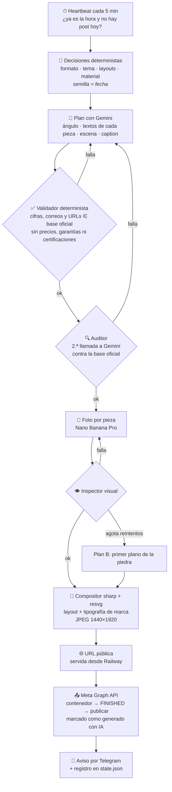

<div align="center">

# Millimeter · SM Automation

**Un agente autónomo que planifica, diseña, valida y publica contenido en Instagram cada día, sin intervención humana y sin inventar un solo dato.**


[El problema](#-el-problema) · [Cómo funciona](#-cómo-funciona) · [Decisiones de ingeniería](#-decisiones-de-ingeniería) · [Control por Telegram](#-control-por-telegram) · [Despliegue](#-despliegue-en-railway) · [Límites](#-límites-conocidos)

</div>

---

## 🎯 El problema

[MILLIMETER by Casanova](https://www.millimetersouthamerica.com/) vende piedra natural en láminas ultrafinas (1–5 mm) para arquitectos y diseñadores en Colombia, Argentina, Perú y Brasil. Su cuenta de Instagram, [`@casanova_southamerica`](https://www.instagram.com/casanova_southamerica/), necesita **publicar a diario con calidad editorial**, y el reto es doble:

1. **Constancia sin un equipo de contenido.** Diseñar, redactar y publicar cada día es caro y fácil de abandonar.
2. **Cero margen de error en los datos.** En un producto técnico, una cifra inventada (peso, espesor, certificación) es un riesgo comercial. Los modelos generativos alucinan por naturaleza.

Este proyecto resuelve ambos: **un bot que trabaja solo, pero que está diseñado en torno a la desconfianza hacia su propio modelo de IA**. Cada texto, cada cifra y cada imagen pasa por barreras deterministas antes de llegar a Instagram.

## ✨ Qué hace

| | |
|---|---|
| 🗓️ **Publica solo, cada día** | Elige formato (post de 1 imagen o carrusel de 3 a 6), tema, layouts y material, y publica a la hora configurada. |
| 🧠 **Solo dice lo que sabe** | Gemini redacta usando exclusivamente una base de conocimiento oficial. Todo número, correo y URL del texto se comprueba contra ella. |
| 🖼️ **Fotos sin texto, tipografía exacta** | Nano Banana Pro genera la fotografía; un compositor propio superpone la tipografía de marca. El nombre, las tildes y las cifras nunca salen deformados. |
| 👁️ **Control de calidad visual** | Un inspector (visión por IA) rechaza juntas visibles, piedra doblada, texto fantasma o personas, y regenera con correcciones. |
| 🛡️ **Idempotente y con tope de gasto** | Un reinicio retoma donde quedó, nunca publica dos veces y nunca supera el presupuesto diario de imágenes. |
| 📱 **Se controla desde el móvil** | Comandos de Telegram para forzar un post, encolar ideas, pausar o cambiar la hora. |

## 🏗️ Cómo funciona



### Las tres barreras contra la alucinación

La IA propone; el código decide. La política de la marca es que **la IA nunca inventa datos técnicos**, así que se aplica en capas independientes:

1. **Base de conocimiento cerrada** ([`knowledge/facts.json`](knowledge/facts.json)). Cada afirmación del plan debe citar un `fact_id` existente. Lo que no está ahí, el bot no lo dice.
2. **Validador determinista** ([`src/validate.mjs`](src/validate.mjs)). Es código, no un modelo: rechaza cualquier número, correo o URL ausente de la base y un léxico prohibido (precios, descuentos, garantías, certificaciones, testimonios, «sin juntas» como promesa absoluta).
3. **Auditor + inspector visual.** Una segunda pasada de Gemini revisa el plan contra la base, y otra revisa cada imagen generada antes de aceptarla.

Si tras 4 rondas el plan no supera las barreras, **ese día no se publica**. Es preferible el silencio a un dato falso.

## 🧩 Decisiones de ingeniería

| Decisión | Por qué |
|---|---|
| **Texto compuesto por código, no por el modelo de imagen** | Los generadores de imagen deforman tildes, logotipos y cifras. Generar la foto sin texto y componer con `sharp` + `resvg` + fuentes embebidas garantiza una tipografía exacta. |
| **Aleatoriedad con semilla = fecha** | Un reintento del mismo día conserva formato y layouts, pero el feed varía entre días. Es reproducible y testeable. |
| **Pipeline idempotente con checkpoints** | Cada etapa persiste en `state.json`. Un crash a mitad de ejecución no regenera (ni cobra) lo ya hecho. Tras un fallo ambiguo al publicar, el bot consulta Instagram antes de reintentar para no duplicar. |
| **Presupuesto como invariante** | Máx. 4 intentos/día, 3 intentos de foto por pieza y un tope duro de imágenes diarias (`MAX_IMAGES_PER_DAY`). Si se alcanza, el bot se detiene y avisa. |
| **Cascada de modelos** | Si el modelo de texto configurado no existe o falla, prueba una lista de candidatos y recuerda el que funciona. |
| **Renovación autónoma del token de Meta** | El token de larga duración (60 días) se renueva solo, se persiste en el volumen y avisa si no puede. |
| **Mínima superficie de dependencias** | Servidor HTTP con `node:http`, scheduler con `setInterval`, Telegram por *long polling*. Solo 3 dependencias de runtime: `@google/genai`, `sharp`, `@resvg/resvg-js`. |
| **Seguridad por diseño** | Autenticación admin con comparación en tiempo constante, sin URL ni token en logs o errores, rutas `/admin/*` que responden 404 si no hay token configurado y nombres de imagen no enumerables. |

## 🎨 Motor de diseño

Siete layouts de marca, elegidos de forma determinista para que el feed nunca se vea repetitivo: la portada no repite ninguno de los tres últimos y no se repite layout dentro de un mismo carrusel.

| Layout | Descripción |
|---|---|
| **A** | Franja oscura |
| **B** | Arco crema |
| **C** | Textura + dato |
| **D** | Dividido |
| **E** | Portada a sangre |
| **F** | Marco revista |
| **G** | Tipográfica |

Tipografía: *Cormorant Garamond* y *Montserrat* (SIL OFL 1.1), embebidas para renderizar sin depender de las fuentes del sistema.

## 📚 Conocimiento (lo que el bot «sabe»)

| Archivo | Para qué |
|---|---|
| [`knowledge/facts.json`](knowledge/facts.json) | Única fuente de datos afirmables (brochure + web oficial). |
| [`knowledge/guia-editorial.md`](knowledge/guia-editorial.md) | Marca, sistema de diseño, estructura del caption, copy y tono. |
| [`knowledge/topics.json`](knowledge/topics.json) | Banco de temas; se elige el menos usado recientemente. |
| [`knowledge/materiales.json`](knowledge/materiales.json) | Los 9 materiales del catálogo y su descripción visual genérica. |

El **caption** sigue un esqueleto fijo del cliente: titular · problema · solución · 4 viñetas · tagline · CTA + contacto · banderas de los países · máx. 5 hashtags.

## 📱 Control por Telegram

El cliente da órdenes al bot desde un chat privado. No hay aprobación por pieza: solo órdenes, y los mismos chats reciben el aviso de cada publicación.

| Comando | Qué hace |
|---|---|
| `/estado` | Qué se publicó hoy, qué viene, ideas en cola, gasto de imágenes y estado del token. |
| `/forzar` · `/forzar <idea>` | Publica un post extra ahora (2–5 min); con idea, sobre ese tema. |
| `/idea <texto>` | Encola una idea para la siguiente publicación programada. |
| `/ideas` · `/borrar_idea <n>` | Ver / quitar ideas de la cola. |
| `/previa` | Genera un borrador **sin publicar** y lo envía al chat. |
| `/pausar` · `/reanudar` | Detiene / reactiva las publicaciones automáticas. |
| `/hora HH:MM` | Cambia la hora diaria. |
| `/usuarios` · `/quitar <n>` · `/desvincular` | Gestionar quién puede dar órdenes. |

Las ideas pasan por **las mismas barreras** que un post automático. Si una idea no se puede convertir en un post válido, el bot avisa el motivo y publica un tema automático.

<details>
<summary><b>Vinculación y seguridad</b></summary>

- **Puesta en marcha:** crea el bot con [@BotFather](https://t.me/BotFather), guarda su token en `TELEGRAM_BOT_TOKEN`, define `TELEGRAM_LINK_CODE` y envía `/vincular <código>` desde el chat.
- **Traspaso al cliente:** el cliente se vincula con el mismo comando; después se quita el chat del desarrollador (`/quitar`) y se **rota `TELEGRAM_LINK_CODE`** para invalidar el código usado.
- **Seguridad:** solo chats privados que enviaron el código correcto (5 intentos fallidos por hora y chat); *long polling* sin webhook expuesto; el token nunca aparece en logs. Sin `TELEGRAM_BOT_TOKEN`, los comandos quedan desactivados.

</details>

## 🚀 Despliegue en Railway

1. Railway → **New Project → Deploy from GitHub repo** → este repositorio.
2. **Networking → Generate Domain** (Meta descarga las imágenes desde ahí; el bot usa `RAILWAY_PUBLIC_DOMAIN`).
3. **Volume** montado en `/data` y `DATA_DIR=/data`.
4. Carga las variables de entorno (ver abajo).
5. Ensayo sin publicar:
   ```bash
   curl -X POST -H "Authorization: Bearer $ADMIN_TOKEN" \
     "https://<dominio>/admin/run?dry=1&count=3"
   ```
   y revisa `GET /admin/status` y los logs.
6. Con el ensayo aprobado, el bot publica solo cada día a la hora configurada.

El servicio expone `/health` para el *healthcheck* y reinicia automáticamente ante fallos ([`railway.json`](railway.json)).

### Variables de entorno

> [!IMPORTANT]
> Las credenciales viven **solo** en el gestor de variables de la plataforma. Plantilla en [`.env.example`](.env.example); el `.env` real está en `.gitignore`.

| Variable | Obligatoria | Nota |
|---|---|---|
| `GEMINI_API_KEY` | ✅ | Con facturación activa (Nano Banana Pro es de pago). |
| `META_ACCESS_TOKEN` | ✅ | Token de larga duración de Instagram Login. |
| `DATA_DIR` | ✅ en Railway | `/data` (Volume). |
| `ADMIN_TOKEN` | recomendada | Habilita `/admin/*`; cadena larga y aleatoria. |
| `IMAGE_ASPECT`, `IMAGE_SIZE` | no | `3:4` y `2K`. |
| `MAX_IMAGES_PER_DAY` | no | Tope duro de imágenes generadas por día (18). |
| `TZ_NAME`, `POST_HOUR`, `POST_MINUTE` | no | Por defecto `America/Bogota`, 10:00. |
| `PAUSED`, `DRY_RUN` | no | Interruptor de emergencia / modo ensayo. |
| `TELEGRAM_BOT_TOKEN`, `TELEGRAM_LINK_CODE` | no | Control y avisos por Telegram. |
| `TELEGRAM_MAX_CHATS`, `TELEGRAM_CHAT_ID` | no | Máx. de chats vinculados (4) · chat extra solo de avisos. |

## 💻 Uso local

```bash
npm install
cp .env.example .env              # completa las claves
npm run once -- --whoami          # verifica el token de Meta
npm run once -- --content         # solo plan y textos (centavos)
npm run once -- --dry --count 3   # plan + fotos + composición, sin publicar (~USD 0.4–1)
npm test                          # 23 tests: validación, diseño, Telegram, fotos
```

## 🗂️ Estructura

```
├── src/
│   ├── server.mjs      # HTTP (health, media, admin) + scheduler + arranque/cierre limpio
│   ├── pipeline.mjs    # orquestación idempotente del día
│   ├── content.mjs     # plan y caption con Gemini + auditor
│   ├── validate.mjs    # barreras deterministas anti-alucinación
│   ├── design.mjs      # formato, tema y layouts con semilla = fecha
│   ├── photo.mjs       # foto + inspector visual + reintentos con tope
│   ├── compose.mjs     # layouts de marca con sharp + resvg
│   ├── meta.mjs        # Instagram API: contenedores, carruseles, renovación de token
│   ├── telegram.mjs    # long polling y vinculación
│   ├── commands.mjs    # comandos del cliente
│   └── state.mjs       # estado persistente (checkpoints)
├── knowledge/          # base de conocimiento y guía editorial
├── assets/fonts/       # tipografía de marca (OFL)
├── test/               # node --test
└── railway.json
```

## ⚠️ Límites conocidos

- Meta exige URL pública para las imágenes: se sirven desde el propio servicio (`/media/<archivo>.jpg`, nombres no enumerables, 30 días).
- La API no soporta stickers interactivos de stories; el bot publica posts de feed.
- Las descripciones visuales de cada material son genéricas: el bot no puede garantizar que una piedra se vea idéntica a la real. Las imágenes son conceptuales, **siempre etiquetadas como generadas con IA** y nunca representan proyectos reales.
- El bot es autónomo por diseño: se recomienda revisar el feed periódicamente y usar `PAUSED=true` ante cualquier duda.

## 🧰 Stack

**Node.js 22** (ESM) · **Gemini API** (`@google/genai`; texto + `gemini-3-pro-image`) · **sharp** + **@resvg/resvg-js** (composición) · **Instagram API / Meta Graph** · **Telegram Bot API** · **Railway** (Railpack, Volume, healthchecks) · `node --test`

---

<div align="center">

Hecho por [**Kin9Zeus**](https://github.com/Kin9Zeus) · Proyecto real en producción para MILLIMETER by Casanova

</div>
